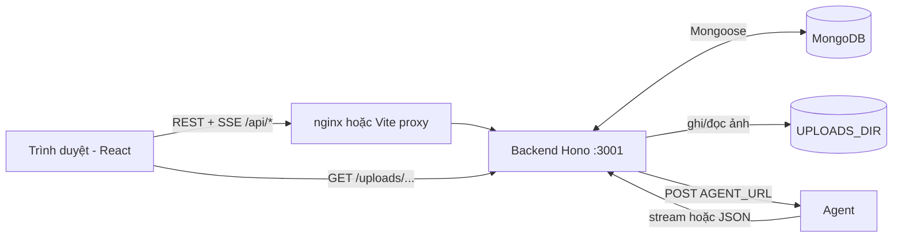
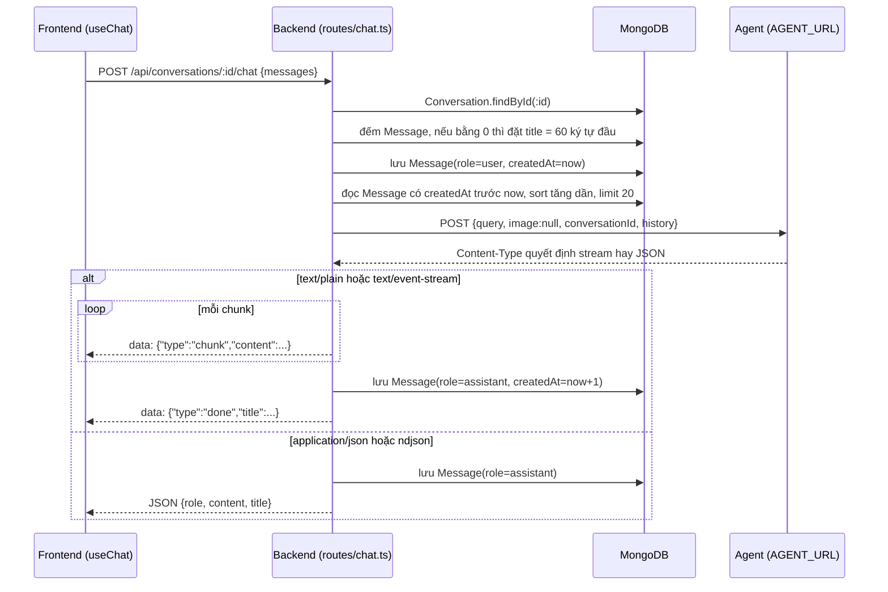
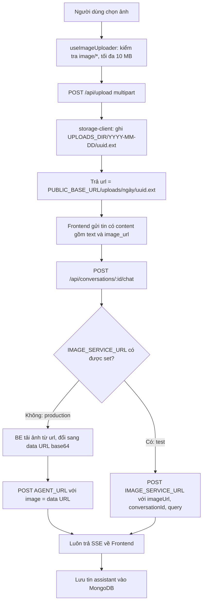

# Luồng dữ liệu (Data Flow) của Chat-UI

Tài liệu mô tả đường đi của dữ liệu trong hệ thống, dựa trên code hiện tại (nhánh `main`, commit `2dc2074`).
Mỗi mục có ghi file nguồn để đối chiếu. Phần "Điểm cần lưu ý" ghi các chỗ code và comment/tài liệu không khớp nhau.

## 1. Thành phần

| Thành phần | Công nghệ | Vai trò | Nguồn |
| --- | --- | --- | --- |
| Frontend | React 19 + Vite + react-router | Giao diện chat, gọi REST/SSE tới Backend | `frontend2/chat-frontend/src` |
| Backend (BE) | Node.js + Hono + Mongoose | API hội thoại, proxy tới Agent, lưu lịch sử, nhận upload ảnh | `backend/src` |
| MongoDB | MongoDB 7 | Lưu `Conversation` và `Message` | `backend/src/db.ts` |
| Thư mục uploads | File system (`UPLOADS_DIR`) | Lưu ảnh người dùng tải lên, BE phục vụ tĩnh tại `/uploads/*` | `backend/src/lib/storage-client.ts` |
| Agent | Dịch vụ HTTP bên ngoài (`AGENT_URL`) | Sinh câu trả lời từ `query`, `history`, `image` | `backend/src/services/graph-interpreter.ts` |

Frontend gọi `/api` cùng origin: ở môi trường dev, `vite.config.ts` proxy `/api` tới `BACKEND_HOST` (mặc định `localhost:3001`); trong Docker, `nginx.conf` proxy `/api/` tới `chat-backend:3001`. Nếu có `window.BACKEND_URL` (từ `config.js`) hoặc `VITE_BACKEND_URL` thì frontend gọi thẳng tới địa chỉ đó (`src/lib/api-base.ts`).

## 2. Mô hình dữ liệu (MongoDB)

Định nghĩa tại `backend/src/db.ts`.

| Collection | Trường | Ghi chú |
| --- | --- | --- |
| `Conversation` | `_id` (UUID string), `title` (mặc định `New conversation`), `createdAt`, `updatedAt` (unix ms) | `title` được đặt từ tin nhắn đầu tiên |
| `Message` | `_id` (UUID), `conversationId` (có index), `role` (`user` / `assistant` / `system`), `content` (kiểu `Mixed`), `createdAt` (unix ms) | `content` là chuỗi, hoặc mảng phần tử `{type:'text'}` / `{type:'image_url'}` khi tin có ảnh |

## 3. Bảng endpoint chính

| Method | Đường dẫn | Mô tả | Cần DB | Nguồn |
| --- | --- | --- | --- | --- |
| GET | `/health` | Trả `{ok, db}` | Không | `index.ts` |
| GET | `/uploads/*` | Phục vụ file ảnh đã tải lên | Không | `index.ts` |
| GET | `/api/conversations` | Danh sách hội thoại, sắp theo `updatedAt` giảm dần | Có | `routes/conversations.ts` |
| POST | `/api/conversations` | Tạo hội thoại rỗng (HTTP 201) | Có | `routes/conversations.ts` |
| GET | `/api/conversations/:id` | Hội thoại kèm toàn bộ tin nhắn (sắp theo `createdAt` tăng dần) | Có | `routes/conversations.ts` |
| DELETE | `/api/conversations/:id` | Xóa hội thoại và mọi tin nhắn của nó (HTTP 204) | Có | `routes/conversations.ts` |
| POST | `/api/conversations/:id/chat` | Gửi tin, nhận câu trả lời (SSE hoặc JSON) | Có | `routes/chat.ts` |
| GET | `/api/conversations/:id/history` | Lịch sử cho backend agent; yêu cầu header `X-Internal-Key`; query `limit` (mặc định 100, tối đa 500), `before`, `role` | Có | `routes/history.ts` |
| POST | `/api/upload` | Tải ảnh lên (multipart, trường `file`), trả `{url}` | Có (xem mục 7) | `routes/upload.ts` |

Khi DB chưa sẵn sàng, mọi route dưới `/api/*` trả HTTP 503 (middleware trong `index.ts`); BE thử kết nối lại mỗi 5 giây.

## 4. Luồng chat văn bản

Các bước chính:

1. **Frontend** (`hooks/use-chat.ts`, `lib/openai-client.ts`): `sendMessage` thêm tin người dùng và một tin assistant rỗng vào state, rồi gọi `streamChatCompletion`. Body gửi lên là `{ messages: [{role, content}, ...] }` (toàn bộ hội thoại trong state).
2. **Backend** chỉ lấy **tin cuối** của `messages` (phải có `role = user`) làm câu hỏi. Lịch sử gửi cho Agent **không lấy từ body** mà đọc lại từ MongoDB.
3. Backend trả lỗi sớm: 404 nếu không có hội thoại, 400 nếu `messages` rỗng, tin cuối không phải `user`, JSON sai, hoặc tin rỗng.
4. **Payload gửi Agent** (`buildPayload`): `{ query, image, conversationId, history }`. `history` là các tin trước đó với `content` dạng chuỗi (nội dung không phải chuỗi được `JSON.stringify`).
5. **Phát hiện kiểu phản hồi của Agent** theo `Content-Type`: chứa `application/json` hoặc `ndjson` thì coi là JSON một cục; còn lại (text/plain, `text/event-stream`...) là stream. Mỗi kiểu có một bộ parse riêng (`readRawText`, `parseSse`, `parseJsonOrLines`).
6. **Stream về Frontend**: Backend đóng gói mỗi chunk thành sự kiện SSE `chunk`, kết thúc bằng `done` (kèm `title`) hoặc `error` (kèm `message`). Frontend ghép từng chunk vào tin assistant đang hiển thị (`parseSseStream`).
7. **Lưu câu trả lời**: sau khi stream xong mới lưu tin assistant với `createdAt = now + 1`. Nếu Agent lỗi giữa chừng, tin assistant không được lưu.
8. **Timeout Agent**: 60 giây, bắt đầu từ lúc gọi, và chỉ được hủy khi generator đọc xong (nên bao cả thời gian đọc stream).
9. **Lỗi/thử lại ở Frontend**: nếu stream lỗi, `useChat` tự thử lại 1 lần (xóa nội dung đang có); lỗi lần hai thì hiện lỗi và xóa tin assistant đang chờ. Nút "Stop" hủy request bằng `AbortController`.

## 5. Luồng ảnh (upload + chat)

- **Upload** (`routes/upload.ts`, `lib/storage-client.ts`): chỉ nhận file có `type` bắt đầu bằng `image/` và dung lượng tối đa 10 MB (cả Frontend lẫn Backend đều kiểm tra). File được ghi vào `UPLOADS_DIR/{YYYY-MM-DD}/{uuid}.{ext}` và trả về URL công khai ghép từ `PUBLIC_BASE_URL`. Backend phục vụ lại file qua `/uploads/*`. Trong Docker, thư mục này nằm trên volume `uploads_data`.
- **Frontend** hiển thị ảnh xem trước bằng base64 ngay lập tức, nhưng khi gửi tin thì gửi **URL đã upload** dưới dạng phần tử `{type:'image_url', image_url:{url}}`.
- **Backend** chỉ dùng **ảnh đầu tiên** (`imageUrls[0]`) cho cả hai đường. Tin chỉ có ảnh (không có chữ) vẫn hợp lệ, và `title` được đặt là `📷 Nhận diện ảnh`.
- **Đường production** (không set `IMAGE_SERVICE_URL`): Backend tải ảnh từ URL, đổi sang `data:<mime>;base64,...`, rồi gửi cho Agent qua trường `image`. Lỗi tải ảnh trả HTTP 502.
- **Đường test** (set `IMAGE_SERVICE_URL`): Backend gửi `{imageUrl, conversationId, query}` tới dịch vụ ảnh giả lập, đọc từng dòng `data: ...` của phản hồi và chuyển thành sự kiện `chunk`.
- Ở cả hai đường, phản hồi về Frontend **luôn là SSE**, kể cả khi Agent trả JSON một cục.
- Nội dung tin người dùng có ảnh được lưu nguyên mảng `content` (có `image_url`) vào MongoDB; khi đưa vào `history` cho Agent thì bị `JSON.stringify` thành chuỗi.

## 6. Luồng hội thoại và hiển thị lại

1. **Vào trang `/`** (`ConversationRedirect`): gọi `GET /api/conversations`; nếu có thì chuyển tới `/:id` của hội thoại mới nhất, nếu chưa có thì `POST /api/conversations` rồi chuyển tới hội thoại vừa tạo.
2. **Vào `/:conversationId`** (`ChatWindow` + `useConversations`): tải danh sách (không kèm tin nhắn), sau đó tải tin nhắn của hội thoại đang mở bằng `GET /api/conversations/:id` và lưu vào cache trong state. Hội thoại đã có tin trong cache thì không tải lại.
3. **Sau khi chat**: Frontend cập nhật state tại chỗ (tin người dùng, các chunk của assistant) và không tải lại từ server. `title` mới (từ sự kiện `done` hoặc JSON) được cập nhật vào sidebar.
4. **Xóa hội thoại**: `DELETE /api/conversations/:id` xóa hội thoại và toàn bộ tin nhắn. File ảnh trong `UPLOADS_DIR` không bị xóa theo.
5. **Cấu hình trình duyệt**: `useConfig` lưu `baseUrl`, `apiKey`, `model`, `systemPrompt` trong `localStorage` (khóa `chatui_config`). Các giá trị này không nằm trong request chat tới Backend (request chỉ mang `messages`).

## 7. Điểm cần lưu ý (code và tài liệu chưa khớp)

Đây là các quan sát từ việc đọc code, chưa kiểm chứng bằng cách chạy hệ thống.

1. **Lịch sử gửi Agent lấy 20 tin cũ nhất.** `chat.ts` đọc `Message.find(...).sort({ createdAt: 1 }).limit(20)`: sắp tăng dần rồi lấy 20 bản ghi đầu, nên với hội thoại dài hơn 20 tin, Agent nhận 20 tin đầu hội thoại chứ không phải 20 tin gần nhất. Endpoint `/history` cũng sắp tăng dần rồi `limit`, nên cùng đặc điểm.
2. **`/api/upload` cần DB.** Comment trong `index.ts` ghi "available without DB", nhưng middleware kiểm tra DB đăng ký cho `/api/*` trước khi gắn route upload, nên upload cũng trả 503 khi DB chưa sẵn sàng.
3. **Comment còn nhắc MinIO.** `routes/upload.ts`, `routes/chat.ts` và `use-image-uploader.ts` vẫn nhắc MinIO/S3, trong khi `storage-client.ts` hiện ghi file ra disk (commit `2dc2074`).
4. **Đường dẫn `config.js` trong `index.html`.** Thẻ script dùng `src="/usr/share/nginx/html/config.js"` (đường dẫn trong container), còn `nginx.conf` chỉ khai báo `location = /config.js`. Nếu file không nạp được thì `window.BACKEND_URL` rỗng và Frontend quay về `/api` (đi qua proxy nginx).
5. **Tin người dùng được lưu trước khi gọi Agent.** Nếu Agent lỗi (HTTP 502) thì tin người dùng vẫn nằm trong DB mà không có tin assistant tương ứng, và lần gửi sau sẽ thấy tin này trong `history`.
